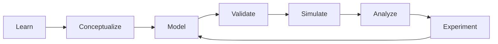
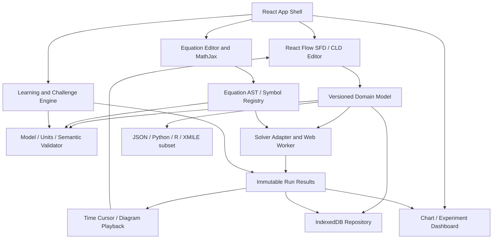

# System Dynamics Studio — PLAN.md

**Full name:** Interactive System Dynamics Modeling, Simulation, Analysis and Learning Environment  
**Application type:** Interactive educational web application  
**Priority:** P1  
**Audience:** Undergraduate and graduate students in Modeling and Simulation, Business Process Management, information systems, and related disciplines  
**Reference implementation:** BPMN Studio's modular teaching workflow and engineering discipline  
**Companion:** [`STYLE.md`](STYLE.md) — the transferable BPMN Studio design language adapted for System Dynamics  
**Status:** Implementation specification and upgrade plan, **not** a claim that every feature is implemented. Progress and evidence: [`docs/architecture/current-state.md`](docs/architecture/current-state.md)

> **Implementation instruction for Codex / Claude Code:** Read this file and `STYLE.md` before changing code. Inspect the existing repository and preserve working functionality. Implement one tested vertical slice at a time. Do not rebuild a working System Dynamics Studio solely to match this plan.

---

## 1. Source baseline, intent and non-negotiables

### 1.1 What the existing README says is already present

The accompanying System Dynamics Studio README describes:

- React + Vite with a React Flow canvas, Zustand state management, and Tailwind CSS.
- Interactive **stocks**, **flows**, and **variables**, including orange dotted information connections and editable equations.
- An **Eqs** panel that renders equations through MathJax.
- A custom **RK4** JavaScript simulation engine with play, pause, reset, trend lines, and current-stock bar charts.
- A theory hub and seven example models: extended population, predator–prey, SIR, Bass innovation adoption, carrying capacity, inventory control, and a World3 / Limits to Growth example.
- Python (SciPy `odeint`) and R (`deSolve`) code export.

These are **README-reported features**. Agents must inspect the actual implementation and tests before labeling any feature complete, robust, correctly implemented, or scientifically validated.

### 1.2 Transfer from BPMN Studio

Preserve the educational/product patterns that made BPMN Studio successful:

| BPMN Studio pattern | System Dynamics Studio equivalent |
|---|---|
| Learn → Model → Validate → Simulate → Analyze → Optimize | Learn → Conceptualize → Model → Validate → Simulate → Analyze → Experiment → Refine |
| BPMN visual editor | Stock-and-flow editor + causal loop modeling |
| Contextual element encyclopedia | Stock, flow, auxiliary, link, feedback, delay and equation explanations |
| Structural and semantic validator | Structural, equation, dimensional and numerical validator |
| Animated token execution | Animated change of levels/flows and a time cursor **driven by actual solver data** |
| Discrete-event performance simulator | Continuous-time stock/flow numerical integration |
| AS-IS vs. TO-BE comparison | Baseline vs. policy/intervention scenario comparison |
| Challenges and guided practice | Model-building, equation, feedback, calibration and policy challenges |
| Repeatable experiments | Reproducible solver configuration, parameter sweeps and sensitivity analysis |
| Modular architecture and local storage | Model/solver/scenario/visualization separation with versioned persistence |

**Do not transplant BPMN notation, token semantics, `bpmn-js`, or a DES engine into this product.** System Dynamics is a distinct modeling paradigm.

### 1.3 Vision

System Dynamics Studio must be substantially more than a diagram editor or chart player. It should enable learners to construct defensible explanations of how a system behaves over time and test alternative assumptions.

Students should be able to:

1. Understand **stocks, flows, auxiliaries, parameters, feedback, delays and nonlinear behavior**.
2. Translate a verbal problem into a **causal loop diagram (CLD)** and/or a **stock-and-flow diagram (SFD)**.
3. Express relationships as equations, with explicit **units** and initial conditions.
4. Catch structural, mathematical and conceptual mistakes **before simulation**.
5. Observe the system evolve using correct, inspectable numerical integration.
6. Analyze behavior-over-time graphs, equilibria, overshoot, oscillations and unintended consequences.
7. Compare baseline and intervention scenarios fairly.
8. Conduct sensitivity, parameter sweep and reproducibility experiments.
9. Complete scaffolded learning exercises with explanatory feedback.
10. Export models, results and reproducible code without misrepresenting supported standards or numerical methods.

### 1.4 Core learning cycle



### 1.5 Success criteria

A successful implementation lets a student take a simple inventory or population problem from narrative → correctly connected stock/flow diagram → documented equations → clean validation → reproducible run → interpreted graph → compared intervention **without leaving the application**. The visual editor, solver, charts and explanation panels must agree about the same model version and simulation state.

---

# 2. Functional modules

## 2.1 Module A — Interactive System Dynamics Modeler

### Objective

Provide an intuitive visual modeler for causal structure and mathematically executable stock-and-flow systems.

### Supported primitives

| Primitive | Meaning | Modeling behavior |
|---|---|---|
| **Stock / level** | Accumulated quantity, state variable | Rectangle, initial value/expression, units; has inflows and outflows |
| **Flow / rate** | Transfer or rate of change | Pipe and valve; points into/out of stocks or clouds; equation with units per time |
| **Cloud / source/sink** | Boundary outside modeled system | Used at external ends of flows; not a stock or dynamically accumulated quantity |
| **Auxiliary / converter** | Intermediate calculated value | Rounded node, equation and units |
| **Parameter / constant** | Scenario assumption | Explicit constant with unit, editable in scenarios |
| **Information link** | Dependency influencing an equation | Directed, orange dashed link; does not move conserved material |
| **Causal link (CLD)** | Hypothesized positive/negative influence | Signed `+` / `−`; independent of physical flow wiring |
| **Feedback loop label** | Reinforcing or balancing conceptual loop | Annotated `R` / `B`, with polarity and assumptions |
| **Annotation / group** | Contextual model documentation | Free text, labels, boundaries, explanatory notes |
| **Lookup / graph function** | Nonlinear input-to-output relation | Tabular/graphical function with interpolation rules; advanced phase |
| **Delay** | Deferred response / adjustment | Explicit modeled delay semantics; advanced phase |

### Interaction requirements

- Drag/drop from a compact palette; keyboard-accessible insertion alternatives.
- Connect stocks to flows using typed, directional ports; connect information influences separately.
- Maintain semantic connectivity in the **domain model**, not merely React Flow edge styling.
- Prevent meaningless link types (e.g., an information arrow becoming a material inflow).
- Support pan/zoom, fit-to-model, minimap, selection, multiselect, align/distribute, duplicate, delete, undo/redo, and keyboard shortcuts.
- Stable IDs independent of names; rename variables safely by updating references through parsed expressions, not naive text replacement.
- Double-click or inspect a node to edit description, equation, initial value, unit and display properties.
- Make equation errors visible before a model run; show dependency references and connected links.
- Save multiple models, duplicate examples, autosave drafts, import/export native JSON and restore sessions.
- Both light and dark theme support, including every custom node and edge.
- Prefer structured geometry over decorative drawing: stock rectangles, distinct flow valves, cloud boundaries, directional information links.
- Separate **CLD workspace** (qualitative hypotheses) and **SFD workspace** (quantitative executable model). A CLD is not automatically an executable model.

### Contextual education

Selecting an element displays its name, purpose, equation meaning, units, impact on the state derivative, common errors, and a tiny example. A stock explains accumulation and initial conditions; a flow explains rate units and direction; an information link explains dependence rather than transfer; a loop explains the interpretation and limitations of causal polarity.

### Acceptance criteria

- A student can build, edit, reopen and export a basic inventory stock-and-flow model.
- Undo/redo and save/reload preserve IDs, topology, equations and layout.
- Diagram links cannot silently create or destroy model equations.
- Editor handles do not allow invalid physical source/target configurations without an explicit warning.

---

## 2.2 Module B — Learning Mode and Theory Hub

### Objective

Deliver progressive, interactive instruction integrated with modeling and simulation rather than a disconnected textbook.

### Learning levels

**Level 1 — Foundations:** systems, boundaries, stocks vs. flows, accumulation, diagrams, units and initial conditions.  
**Level 2 — Feedback:** causal loop diagrams, `+`/`−` links, reinforcing and balancing loops, delays, exponential growth and goal seeking.  
**Level 3 — Quantitative models:** auxiliary equations, parameters, nonlinearities, rate equations, carrying capacity, equilibrium and conservation.  
**Level 4 — Simulation:** Euler vs. RK4, step size, numerical error, initial conditions, output sampling and solver assumptions.  
**Level 5 — Complex behavior:** oscillation, overshoot, supply chains, SIR, predator–prey, policy resistance, model boundaries and validation.  
**Level 6 — Experimentation:** baseline vs. intervention, sensitivity, uncertainty, calibration, reproducibility and interpretation.

### Each lesson contains

1. A short explanation in direct language.
2. A diagram or behavior-over-time graph.
3. A **live miniature model** the student can change safely.
4. A typical misconception and why it fails.
5. A short exercise with progressive hints.
6. A knowledge check and formative feedback.
7. A link to the full modeler or relevant challenge.

### Example micro-lessons

- **A stock is an accumulation:** raise the inflow and see the stock slope change, not its level jump instantaneously.
- **Flow is not information:** moving an influence arrow must not transfer inventory.
- **Positive feedback is not always good:** `R` means amplification, not desirability.
- **A balancing loop does not guarantee stability:** delays can produce oscillation.
- **Time step matters:** compare Euler and RK4 at multiple step sizes on the same problem.
- **Correlation is not a causal link:** a CLD polarity is a hypothesis needing justification.

### Learning progress

Track completed concepts/challenges locally, not a distracting point economy. Provide restartable lessons, show explanations after an attempt, and let students inspect the exact worked model used by a lesson.

---

## 2.3 Module C — Model and Equation Validator

### Objective

Explain modeling errors, mathematical inconsistencies and numerical limitations before they become plausible-looking but wrong charts.

### Validation levels

| Level | Meaning | Example |
|---|---|---|
| **Error** | Cannot simulate under supported semantics | Undefined symbol, illegal material edge, algebraic cycle |
| **Warning** | Can simulate, but behavior/assumption may be problematic | Likely negative stock, suspicious time step |
| **Recommendation** | Modeling or teaching improvement | Missing units or unclear parameter description |
| **Information** | Explanation or unsupported optional analysis | CLD loop has no executable equations |

### Structural checks

- Orphaned flows; material edges with incompatible endpoints; flow direction mismatches.
- Duplicate IDs/names, ambiguous symbol references, unused auxiliary nodes, inconsistent implicit clouds.
- Missing initial conditions, incomplete stock/flow definitions, orphaned information links.
- Algebraic dependency graph correctness; topological ordering among auxiliaries/flows **for a fixed state and time**.
- Algebraic cycles **without a state/delay boundary** produce errors unless a separately specified algebraic solver is implemented.
- Feedback through stocks is legitimate; do **not** flag every graphical cycle as a mathematical error.

### Equation and unit checks

- Parse expressions into a math.js AST; reject unavailable functions, syntax errors and undefined symbols.
- Detect division-by-zero hazards, invalid domains (`sqrt`, `log`), NaN/Infinity and unsupported conditionals or functions.
- Provide equation and unit previews in the editor; use an explicit unit vocabulary and time unit.
- Check: a stock is in e.g. `items`; its derivative/flows should be `items/day` when model time is days.
- Flag dimensionally incompatible sums, comparisons and function arguments when metadata permits. Distinguish **unit unknown** from **unit valid**.
- Clarify nonnegative flow policy, flow sign conventions and any prohibited negative stock states.
- Report when a user equation refers to a diagram element that has no declared information dependency or vice versa; offer a sync/fix, not silent mutation.

### Simulation checks

- Validate initial conditions and integration horizon (`start`, `stop`, `dt`, reporting interval).
- Flag nonfinite intermediate RK4 stage values, domain violations, explosive trajectories and integration-step sensitivity.
- Detect when output intervals do not divide the requested horizon and define the final short step/reporting behavior explicitly.
- Warn that numerical stability and physical plausibility are distinct; higher-order RK4 is **not** an unconditional accuracy guarantee.
- Identify missing solver support for stochastic terms, discontinuities, delays, lookups or XMILE features.

### Feedback format

Every issue includes severity, element/equation, plain-language reason, consequence, suggested change, and linked mini-lesson. Clicking a validation row focuses the relevant node or expression. Separate **structural validity**, **equation validity**, **unit validity**, **numerical suitability**, and **educational suggestions**.

### Acceptance criteria

- Bad equations do not silently produce a graph.
- Illegal algebraic loops are distinguished from feedback through stocks.
- Valid minimal models pass; invalid test fixtures produce actionable feedback.
- Unit checker never claims correctness if units are absent or its analysis is inconclusive.

---

## 2.4 Module D — Simulation Engine and Time Playback

### Objective

Accurately integrate continuous-time state equations and let students inspect how values evolve.

### State semantics

For each stock `S_i`, the model defines a derivative based on physically connected rates:

```math
\frac{dS_i}{dt} = \sum_{f \in \mathrm{In}(S_i)} f(t,\mathbf S,\mathbf P) - \sum_{f \in \mathrm{Out}(S_i)} f(t,\mathbf S,\mathbf P)
```

- **Stocks** are state variables with initial values.
- **Flows/auxiliaries** are recomputed from current time and trial state; they do not accidentally retain stale RK4-stage values.
- **Parameters** are fixed within a run unless a documented exogenous time function or scenario schedule changes them.
- **Clouds** represent model boundaries; not implicit stocks.
- **Information links** are dependencies, not transfer or conservation equations.
- **Time units** must be explicit and consistent with rates.

### Solver capabilities

**Foundation:** fixed-step Euler and classical RK4 (retain the current RK4 implementation, but audit it for correct intermediate-stage recomputation).  
**Advanced:** optional adaptive solver or additional methods only after validation of the fixed-step engine; method choice must appear in run metadata and code export.

Expose start time, end time, integration `dt`, output sampling interval, solver, time unit, and initial conditions. Handle a final partial step or an explicitly documented fixed-step-only constraint; never silently overshoot. Cache compiled ASTs and static evaluation order. Execute the solver in a Web Worker for models/experiments that would block rendering, with cancel and progress controls.

### Simulation controls

- **Run**, play, pause, stop, reset, step forward; speed only changes **visual playback**, not the solved trajectory.
- Scrub along an already calculated time series; update diagrams and inspector to the exact sampled/interpolated time.
- Display current stocks, flows, parameters, time and solver configuration.
- Show live rate/level badges and animation **from solver results**, not an unrelated hand-authored animation.
- Provide an optional run trace at chosen times, including equation dependencies and calculated derivatives.
- Distinguish **solve** (numerical computation) from **playback** (visualizing saved results).

### Numerical and scientific integrity

- Compile equations once and evaluate each RK4 stage against the correct stage-specific stock vector and time.
- Maintain purity: a derivative calculation may not mutate saved model state or accumulate hidden side effects.
- Support deterministic repeatability; numerical results must not depend on browser animation frame rate.
- Never silently clamp negative stocks or rates. If a nonnegativity constraint is enabled, define its semantics and clearly report when it affected the trajectory; compare against unconstrained integration where meaningful.
- Warn on large steps, discontinuities, fast time constants and unstable/exploding behavior.
- For stochastic extensions, define sample timing/seed and avoid sampling fresh random noise unpredictably at each RK4 substage; such models may require a different numerical treatment.
- Do not claim research-grade accuracy solely because RK4 is selected.

### Worked numerical references

| Test model | Expected property |
|---|---|
| Constant inflow `dS/dt = 3`, `S(0)=2` | `S(10) = 32` |
| Exponential decay `dS/dt = -kS` | Analytical `S(t)=S0*exp(-kt)`; compare error convergence |
| Logistic growth | Near-zero early growth when initial population is tiny; approaches carrying capacity for positive parameters |
| Two-stock transfer | Total stock conserved within numerical tolerance when only internal transfer occurs |
| SIR without births/deaths | `S + I + R` conserved; no artificial new population |
| Predator–prey | Qualitatively oscillatory behavior for standard positive parameters, with quantitative checks against a reference solver |
| Euler vs. RK4 | RK4 shows expected convergence order in smooth test problems; neither result is automatically trusted at coarse `dt` |

### Acceptance criteria

- Simple analytical models meet documented tolerances and show expected convergence under step refinement.
- Playback never changes model equations or numerical results.
- Pause/reset/step accurately match the trace and charts.
- A solver failure reports which variable/time/stage failed and does not leave a misleading "successful" graph.

---

## 2.5 Module E — Behavior Analysis and Visualization

### Objective

Enable students to interpret dynamic behavior, not just view colorful charts.

### Dashboard

- **Behavior-over-time lines** with units, legend, hover inspection, linked time cursor and synchronized diagram highlights.
- **Current levels/rates** shown separately, because they may have different dimensions.
- **Comparison overlays** with visible baseline/intervention legend.
- **Phase plots** (`X` vs `Y`) for oscillations and nonlinear systems; optional in advanced phase.
- **Reference/target curves** for calibration exercises.
- **Sortable data table** accompanying all chart views; export CSV.
- **Equation view** (retain existing Eqs / MathJax) generated from the same parsed equations used by the solver.
- **Run metadata** in every result: model version, scenario, solver, time range, `dt`, units, seed if applicable.

### Analytical measures

- Initial/final values, peak/minimum, peak time, percent change and area under curve where meaningful.
- Rate of change and equilibrium/steady-state indicators **when supported**.
- Overshoot beyond target, settling behavior and oscillation descriptors with clearly documented thresholds.
- Model-specific measures (e.g., SIR infection peak, inventory stockouts), not universal claims.
- Sensitivity/correlation analyses labeled as exploratory rather than causal proof.

### Educational interpretation

Provide prompts: What rises first? Which feedback structure explains the peak? What changes after a policy delay? Is a seemingly stable plot an artifact of chosen horizon or `dt`? What are the units? Prefer interpreted charts with clear assumptions to a wall of KPIs.

---

## 2.6 Module F — Scenario Experiments and Policy Design

### Objective

Allow controlled baseline → intervention → comparison experiments, equivalent in educational purpose to BPMN Studio's AS-IS / TO-BE analysis.

### Scenario workflow

1. Save a **baseline** model/configuration.
2. Record solver, horizon, time units, initial conditions and assumptions.
3. Duplicate the scenario as an **intervention**.
4. Change parameters, lookup functions, policy triggers, or (explicitly) model structure.
5. Run both under comparable conditions.
6. Overlay output trajectories and compute differences.
7. Explain tradeoffs, delays and unintended consequences.
8. Save the comparison and export reproducible evidence.

### Experiments

- One-at-a-time parameter variation.
- Two-parameter grid/surface exploration in advanced phase.
- Parameter sweep with min/max/step or logarithmic grid (validate domain).
- Sensitivity ranking and a standardized view of output ranges.
- Advanced seeded Monte Carlo/uncertainty simulations with distribution assumptions and replicate tracking; report intervals, not certainty.
- Scenario schedules such as a policy step at time `t`, piecewise parameter changes, and temporary interventions.
- Optional calibration to uploaded observations in later phases; never confuse fitted parameters with validated causal structure.

### Fair comparison rule

By default scenarios share initial conditions, solver, time domain, output sampling and controlled random seeds. If differences exist, disclose them visibly before offering performance conclusions. Record model-version differences separately from parameter-only changes.

### Example questions

- Does hiring reduce an inventory backlog, or does the bottleneck move?
- What happens when a policy has a 30-day delay?
- Which adoption parameter changes the Bass diffusion peak most?
- Does an intervention lower an infection peak, shift its timing, or both?
- Is the result robust across plausible parameter ranges?

---

## 2.7 Module G — System Dynamics Challenges

### Challenge types

| Type | Student action | Evaluation |
|---|---|---|
| Identify stocks and flows | Classify elements in a scenario | Typed semantic constraints plus explanation |
| Build a stock-flow model | Model a verbal problem | Required variables, connectivity, equations, behavior |
| Fix a broken model | Repair wrong signs, references and units | Validation improvements and reference tests |
| Predict behavior | Sketch/choose a behavior-over-time curve | Trajectory and conceptual reasoning |
| Explain feedback | Identify `R/B` loops and delays | Loop polarity supported by explicit causal assumptions |
| Numerical method lab | Compare time steps and solvers | Error observations, convergence, explanation |
| Calibrate a parameter | Match a simple observed series | Objective function, units and justified constraints |
| Policy design | Meet a goal without unacceptable side effects | Reproducible scenario results and rationale |
| Compare alternatives | Explain contrasting trajectories | Comparison fairness and reasoning |

### Assessment principles

Do **not** compare diagrams only by visual coordinates or exact node arrangement. Equivalent formulations may be valid. Evaluate semantic graph structure, equation behavior, dimensional consistency, numerical trace/invariants, scenario-specific requirements and written reasoning. Provide explanations, hints and references, not only a score.

### Learning feedback

- What is correct and what still needs work.
- Why a structural, numerical or conceptual issue matters.
- A next action to improve the model.
- Optional hint levels; show a worked reference after completion or exhaustion.

---

## 2.8 Module H — Model Library and Case Studies

Preserve all seven models described by the README and improve them into documented teaching artifacts.

| Example | Primary concepts | Scientific/teaching tests |
|---|---|---|
| Extended population | Inflow, outflow, exponential growth, net migration | Check rate/stock units; simple limiting cases |
| Lotka–Volterra | Nonlinear coupled stocks, endogenous oscillations | Positive parameter semantics and reference traces |
| SIR epidemic | Conservation, nonlinear contact, infection peak | Population conservation and nonnegative state policy |
| Bass adoption | Innovation, imitation, S-curves | Adoption stock bounded by market potential when modeled correctly |
| Carrying capacity | Balancing feedback and limits to growth | Logistic reference solution and equilibria |
| Inventory control | Adjustment delay, oscillation, ordering policy | Units for goods, goods/time, and time |
| World3 / Limits to Growth | Interconnected sectors, delay and policy experiments | **Label provenance and simplifications**; do not imply fidelity to an official World3 calibration without evidence |

Each example has description, diagram, equations, units, time horizon, intended behavior, adjustable parameters, expected plots, learning prompts, tests and named limitations. Provide beginner and advanced variants as appropriate. Add business-oriented cases (project backlog, hiring pipeline, service capacity) later.

---

## 2.9 Module I — Import/Export and Reproducibility

### Native format (required)

Use a versioned **JSON document** that stores domain graph, visual positions, equations, units, solver defaults, view configuration and metadata. Make it human-inspectable and round-trip stable. Use an explicit schema version and migrations.

### Scientific export (retain, then verify)

- **Python:** retain existing SciPy `odeint` export as a compatibility path; consider modern `solve_ivp` as an additional explicit method. Ensure generated code's equations, initial state, times and solver choices are clearly documented.
- **R:** retain `deSolve`, with correct state ordering, parameters and units/comments.
- **Data:** CSV time series and JSON run bundle with solver settings and provenance.
- **Images:** SVG/PNG diagram and chart exports with readable labels and permitted attributions.
- **Equations:** Markdown/LaTeX equation report from the same AST used by computation.

### XMILE / interoperability (advanced, bounded scope)

Investigate **OASIS XMILE 1.0** as a standard interchange target. Start with a declared **supported subset** (basic stocks, flows, auxiliaries, constants, simple equations and simulation configuration). Support only features you can round-trip and test; do not claim general XMILE compliance. Graph/layout representation and advanced functions may differ by tool.

**Reference:** https://docs.oasis-open.org/xmile/xmile/v1.0/xmile-v1.0.html

**SDEverywhere** is a relevant reference/toolchain for transforming **Vensim** models to C/JS/WASM, but is **not** a drop-in replacement for an interactive React Flow model editor or a general XMILE parser. Evaluate it only if cross-tool execution or research interoperability becomes a concrete requirement: https://sdeverywhere.org/

### Export correctness

Each exporter must pass **round-trip or cross-execution tests** on representative examples. A Python/R script that merely looks plausible is not enough. Document supported equations/functions, integration method differences, tolerances and unsupported features.

---

# 3. Technical architecture

## 3.1 Recommended stack — preserve the current app

| Concern | Technology / decision | Notes |
|---|---|---|
| UI | React + TypeScript + Vite | Existing README says React/Vite; adopt TS incrementally if still JS |
| Diagram editor | **React Flow / `@xyflow/react`** | Keep existing custom nodes and edge interactions; migrate package only if needed |
| App state | Zustand | Separate editable model state from active simulation frame/results |
| Styling | Tailwind CSS + **central semantic CSS variables** | Preserve Tailwind; move visual semantics to `STYLE.md` tokens |
| Icons | Lucide | Outline, compact, consistently themed |
| Equations | math.js AST + explicitly restricted function registry | Compile and validate; no raw JavaScript evaluation |
| Math rendering | MathJax | Display representations derived from parsed equations |
| Numerical solvers | Custom pure TypeScript module (Euler + verified RK4) | Worker for expensive jobs; reference tests |
| Time-series/charts | Recharts | Maintain chart/axis/theme consistency |
| Persistence | IndexedDB; local-first | Store models/scenarios/run metadata; migrate old formats |
| Validation | TypeScript + JSON Schema (e.g. Zod/JSON Schema tooling) | Central domain contracts |
| Testing | Vitest + Testing Library + Playwright | Solver fixtures and browser flows |
| Heavy compute | Web Worker | Cancellation, progress, message schema |
| Optional interoperability | XMILE subset / SDEverywhere investigation | No mandatory engine migration |

**Libraries to verify against current project versions:** https://reactflow.dev/learn , https://mathjs.org/docs/expressions/parsing.html , https://mathjs.org/docs/expressions/security.html , https://recharts.org/ . Confirm current licenses/dependency versions before adoption. `@xyflow/react` is the current React Flow package; do not blindly rename a functioning earlier dependency.

## 3.2 Architecture principles

1. **Separate visual layout and domain semantics:** React Flow coordinates are not the simulator's source of truth.
2. **Separate models, scenarios and runs:** editing a diagram after a run cannot rewrite historical results.
3. **Separate solve from playback:** animation rate has no effect on solver `dt`.
4. **Explicit mathematics:** support only documented functions, numeric assumptions and policies.
5. **Local-first operation:** offline functionality without mandatory login or paid backend.
6. **Testable pure numerical core:** no React/Zustand coupling inside the solver.
7. **Reproducibility:** immutable run config and deterministic execution where expected.
8. **Educational explanation:** contextual guidance derived from actual graph/equations.
9. **Accessible, responsive workspace:** keyboard alternatives and complete themes.
10. **Incremental delivery:** preserve and improve existing capabilities with regression tests.

## 3.3 Logical architecture



## 3.4 Domain contracts

Design **and test** contracts before parallel feature implementation. Indicative TypeScript (adapt names to the repository; do not conflate renderer edges and model relations):

```ts
type ModelId = string;
type ElementId = string;
type Unit = string; // normalized through a unit registry

type Stock = {
  id: ElementId;
  name: string;
  initialEquation: string;
  unit: Unit;
  description?: string;
};

type Flow = {
  id: ElementId;
  name: string;
  equation: string;
  sourceStockId?: ElementId; // absent = outside boundary / cloud
  targetStockId?: ElementId; // absent = outside boundary / cloud
  unit: Unit;               // stock unit / model time unit
};

type Auxiliary = {
  id: ElementId;
  name: string;
  equation: string;
  unit?: Unit;
  kind: 'auxiliary' | 'parameter';
};

type InformationLink = { id: ElementId; from: ElementId; to: ElementId };

type TimeConfig = {
  start: number;
  stop: number;
  integrationDt: number;
  outputDt: number;
  timeUnit: string;
  method: 'euler' | 'rk4';
};

type SDModel = {
  schemaVersion: number;
  id: ModelId;
  revision: string;
  name: string;
  stocks: Stock[];
  flows: Flow[];
  auxiliaries: Auxiliary[];
  infoLinks: InformationLink[];
  // CLD structures, annotations and editor layout stored separately
  timeConfig: TimeConfig;
};

type Scenario = {
  id: string;
  modelRevision: string;
  parameterOverrides: Record<ElementId, number>;
  initialOverrides?: Record<ElementId, number>;
  interventionSchedule?: unknown; // define strongly-typed union when implemented
};

type SimulationRun = {
  id: string;
  modelRevision: string;
  scenarioId: string;
  config: TimeConfig;
  timestamps: number[];
  series: Record<ElementId, number[]>;
  completed: boolean;
  diagnostics: string[];
};
```

**Contract refinements required before implementation:** model entity unions, stock↔flow relationships and two-stock transfers, internal unit representation, derived series, deterministic result ordering, version hashes, typed intervention schedules, renderer layout, identifiers/renaming, solver diagnostics and schema migrations. Do not treat the illustrative snippet as a final schema.

## 3.5 Compilation/evaluation pipeline

1. Load versioned model and reconstruct domain graph.
2. Parse all equations into ASTs; reject assignments, unknown symbols and unsupported constructs.
3. Build symbol table and dimension metadata from stable IDs/names.
4. Derive auxiliary/flow dependency graph, identify algebraic cycles and get evaluation order.
5. Validate stock balance equations, units, initial conditions and numerical settings.
6. Compile ASTs once; create **pure** `evaluateDerivatives(t, state, scenario)` function.
7. Run solver using recomputed auxiliaries/flows at each requested stage.
8. Calculate result series/diagnostics and preserve immutable metadata.
9. Render plots and playback frames from the same result.

### Equation safety

- Never use `eval`, `new Function`, or execute uploaded code.
- Restrict permitted math.js symbols/functions with an allowlist; deny assignment, import, function definition and expensive/nested expressions beyond configured complexity limits.
- Execute expensive work in a cancellable Web Worker; set resource/iteration and result-size limits.
- Treat imported model content as untrusted; encode user text in tooltips and equation views.
- Note: math.js' AST parser helps but **does not eliminate** security and performance risks. Follow its published hardening guidance.

## 3.6 Suggested repository structure

```text
system-dynamics-studio/
├── PLAN.md
├── STYLE.md
├── README.md
├── src/
│   ├── app/                    # shell, routes, theme, application boot
│   ├── components/             # reusable buttons, cards, tabs, dialogs, panels
│   ├── features/
│   │   ├── modeler/            # React Flow canvas, custom nodes and edges
│   │   ├── causal-loops/       # CLD, polarity labels, loop explanations
│   │   ├── equations/          # editor, MathJax and expression helpers
│   │   ├── validation/         # explainable checks and issue navigation
│   │   ├── simulation/         # run controls and playback
│   │   ├── analytics/          # time series, dashboards, table export
│   │   ├── experiments/        # baseline, interventions, sweeps
│   │   ├── learning/           # theory hub and micro lessons
│   │   ├── challenges/         # exercise/assessment framework
│   │   ├── examples/           # model catalog and fixtures
│   │   └── export/             # JSON/Python/R/interchange
│   ├── domain/
│   │   ├── model/              # versioned stock/flow/auxiliary types
│   │   ├── equations/          # AST, symbol lookup, evaluation order
│   │   ├── units/              # unit metadata and dimensional checks
│   │   ├── simulation/         # pure Euler/RK4 and numerical diagnostics
│   │   ├── scenarios/          # overrides, time policies, run provenance
│   │   └── assessment/         # semantic rubrics
│   ├── workers/                # simulation worker and messages
│   ├── data/                   # lessons, examples and challenges
│   ├── storage/                # IndexedDB migrations and repositories
│   ├── services/               # portability/export adapters
│   ├── styles/                 # tokens, shell, modeler theme, features
│   └── utils/
├── tests/
│   ├── fixtures/               # analytical numerical reference cases
│   ├── unit/
│   ├── integration/
│   └── e2e/
└── docs/
    ├── architecture/
    ├── numerical-methods/
    ├── semantics-and-units/
    └── teaching-content/
```

**Migration rule:** This is a target organization, not a command to move every existing file at once. Preserve git history and working routes; migrate by module as features are touched.

## 3.7 Persistence and versioning

- Persist models and scenarios independently; snapshots identify exact equation/topology revision.
- Store run metadata and optional trace separately from UI selection state.
- Include schema migrations for existing README-era documents and local storage keys.
- Back up existing data before migrations; never drop user-created models silently.
- Autosave with clear status, recovery from incomplete drafts and import/export for portability.
- In model imports, handle collisions and unsupported features through a preview/validation step.

## 3.8 Performance and accessibility

- Debounce expensive validation while editing; validate conclusively before solve.
- Memoize custom nodes/edges; avoid rerendering all nodes for every playback frame.
- Virtualize large result tables; downsample chart rendering only (not stored numeric data) with documented rules.
- Solvers should not block the main thread; allow cancellation.
- Accessible names for every icon button, keyboard route to edit connections, focus management, contrast in dark mode and reduced motion.
- Keep the mobile experience usable for inspecting, learning and playback; advanced canvas editing may be best on desktop, but never trap users in inaccessible controls.

---

# 4. Development roadmap

> **Status convention:** `[ ]` means **needs verification/implementation**, even when README describes the feature. Change to `[x]` only after inspecting the code and passing acceptance tests. Mark `existing / refine` in the project tracker rather than assuming it is done.

## Phase 0 — Repository audit and protection (first)

**Goal:** Establish reality, preserve value and avoid regressions.

- [x] Inventory installed packages, source layout, routes, features and sample data.
- [x] Run build, lint and tests; record current failing checks and warnings.
- [x] Verify existing editor, Eqs panel, RK4, charts, theory hub, examples and Python/R export.
- [x] Identify data storage format and capture backup/migration fixtures.
- [x] Screenshot representative light/dark workflows for style parity.
- [x] Write `docs/architecture/current-state.md` and feature gap matrix.
- [x] Decide minimal incremental TypeScript and dependency migration strategy.

**Acceptance:** Existing supported examples still load and simulate; the team knows which README claims are confirmed, incomplete or untested.

## Phase 1 — Design-system and domain foundation

- [x] Implement `STYLE.md` semantic tokens in current Tailwind/theme layer.
- [x] Create reusable shell, cards, toolbars, inspectors, dialogs, status components and chart theme.
- [x] Apply complete light/dark states to React Flow custom nodes and handles.
- [x] Define versioned domain model independent of canvas positions.
- [x] Implement model import/export and safe data migrations.
- [x] Stabilize model revisions and undo/redo.
- [ ] Add UI component and domain-contract tests. *(domain-contract and store behaviour tests done; rendered-component tests pending)*

**Acceptance:** A model can be created, exported, imported and run without semantic changes; the UI follows the BPMN Studio visual language in both themes.

## Phase 2 — Modeling semantics and validation

- [x] Audit stock/flow/cloud direction rules and information link behavior.
- [x] Add AST symbol/dependency analysis and safe function registry.
- [x] Implement structural, equation and algebraic-loop diagnostics.
- [ ] Add units/time unit fields and basic dimensional checks. *(declared stock/flow units compared; no dimensional algebra inside expressions yet)*
- [x] Add explainable validation panel with canvas focus and suggested corrections.
- [x] Synchronize equation view with the solver's expression source.
- [x] Add missing-link/dependency consistency checks.

**Acceptance:** Intended feedback via stocks works; undefined symbols/algebraic loops/invalid rates are explained before solving.

## Phase 3 — Verified simulation and playback

- [x] Characterize and test existing RK4 algorithm at each stage.
- [x] Add Euler comparison solver.
- [x] Centralize pure derivative evaluation and immutable simulation results.
- [x] Correct handling of `dt`, start/end, reporting timestamps and failure states.
- [ ] Introduce worker execution and cancellation if needed for performance. *(not yet needed: runs capped at 200k steps)*
- [x] Link play/pause/scrub/step to stored numerical trace.
- [x] Add analytical tests for constant inflow/decay, conservation, logistic and SIR.
- [x] Show numerical settings and reproducibility metadata in results.

**Acceptance:** Numerical benchmarks meet tolerance, chart/playback times align and solver failure cannot appear as a completed valid run.

## Phase 4 — Analytics and experimentation

- [ ] Improve trend and stock-level views; add unit-aware series legends. *(done; browser-verified)*
- [x] Add synchronized time cursor, data table and CSV export.
- [x] Implement baseline vs. intervention scenario model.
- [ ] Add side-by-side and overlaid comparisons. *(overlay and comparison table done; side-by-side pending)*
- [x] Build parameter sweeps and simple sensitivity views.
- [ ] Add interpretation prompts and run provenance to reports. *(compare view and CSV header; no report export yet)*

**Acceptance:** Students reproduce a scenario comparison and identify which parameter changed, under identical numerical settings.

## Phase 5 — Educational layers and challenges

- [ ] Rework theory into interactive progressive lessons.
- [ ] Add contextual element/concept encyclopedia and micro simulations.
- [ ] Turn seven README examples into documented, tested lesson models.
- [ ] Implement build/fix/predict/explain/compare challenges. *(build, fix and predict done, one each; explain and compare pending)*
- [x] Build rubric-based assessment with progressive hints.
- [x] Save local learning progress and provide reset options.

**Acceptance:** Students complete a stock/flow introductory challenge with immediate, explainable feedback without needing an instructor to interpret errors.

## Phase 6 — Advanced modeling and interoperability

- [ ] CLD workspace with `+`/`−` polarity and `R/B` loop annotation.
- [ ] Explicit CLD↔SFD teaching workflow; conversion remains assisted and qualified.
- [ ] Implement and test nonlinear lookup functions.
- [ ] Add documented first-/higher-order delays only when mathematically specified.
- [ ] Add scenario event/policy schedules with solver semantics.
- [ ] Investigate subset XMILE import/export and regression test round-trips.
- [x] Audit Python `odeint` and R `deSolve` parity; optionally add `solve_ivp`.
- [ ] Add parameter uncertainty/seeded Monte Carlo in bounded scope.

**Acceptance:** Advanced behaviors are mathematically documented, tested and explicitly limited where unsupported. No unsupported feature silently evaluates as a constant or is discarded on export.

## Phase 7 — Quality, teaching release and documentation

- [ ] Full Playwright flows: new model → validation → solve → compare → export.
- [ ] Full theme/responsive/keyboard/accessible-dialog audit.
- [ ] Dependency/license review and input security assessment.
- [ ] Performance tests for medium models and large runs.
- [ ] Review numerical and example claims with subject-matter expertise.
- [ ] Publish model schema, supported equation language and solver limitations.
- [ ] Update README to reflect **verified** current behavior, not this roadmap.

**Acceptance:** Release checklist passes; known limitations are visible to users and maintainers.

---

# 5. Testing strategy and definition of done

## 5.1 Test layers

| Layer | Required tests |
|---|---|
| Domain | Flow direction, stock derivatives, symbol naming, graph integrity |
| Parser | Good/bad expressions, unknown symbols, forbidden operations, complexity limits |
| Units | Stock vs. stock/time, incompatible addition, dimensionless functions |
| Solvers | Analytical ODEs, order of convergence, stage recomputation, end-step behavior |
| Invariants | Conservation of internal transfers, SIR total, appropriate boundary accounting |
| Scenarios | Immutable baseline, overrides, consistent time axes and settings |
| Export | JSON round-trip; Python/R numerical parity for supported subset |
| UI | Edit/select/undo/import, validation navigation, playback/chart synchronization |
| Themes | Light/dark contrast, chart labels, node/edge selection and warning states |
| Accessibility | Keyboard model creation path, named controls, dialogs, focus, reduced motion |

## 5.2 Representative acceptance walk-through

**Inventory management lab:** Start with a stock of 100 units; incoming goods flow 20 units/day and demand 15 units/day. With constant flows and 10 days, expected inventory = 150 units. Verify units, run Euler and RK4, inspect the graph at day 10, change demand to 25 units/day in an intervention, compare the trajectories, save both runs and export the results. Confirm the baseline was not overwritten.

**SIR lab:** Check `S+I+R` conservation, verify model equations for transfer S→I→R, inspect peak infection time and compare infection-rate interventions. Ensure the plotted behavior and reported metrics originate from the same solver result.

**Broken model lab:** Supply a rate equation using an unknown symbol, a mismatched rate unit and an algebraic loop. Validate that all three problems appear with distinct actionable explanations and the run is blocked for fatal errors.

## 5.3 Definition of done (every feature)

A feature is done only when it includes:

- Working UI and domain behavior, not screenshots/mockups alone.
- Unit/integration tests and appropriate E2E coverage.
- Light/dark styling from `STYLE.md`, keyboard/focus behavior and clear loading/error/empty states.
- Explicit unsupported cases and safe failure behavior.
- Documentation of assumptions, solver methods, units and examples.
- No loss of saved models and no regression in existing supported flows.

---

# 6. Development agents

## 6.1 Agent responsibilities

**Agent 1 — Architecture & integration:** define contracts, migrations, dependency boundaries, roadmap integration, reviews and release notes.

**Agent 2 — Visual modeler & CLD:** React Flow custom node/edge editing, typed links, layout, undo/redo, semantic graph transformations and contextual inspector.

**Agent 3 — Equations & validation:** math.js AST, safe functions, dependencies, dimensional checks, diagnostics and MathJax equation display.

**Agent 4 — Numerical simulation:** derivative evaluator, Euler/RK4 correctness, time semantics, worker protocol, traces, benchmarks and numerical diagnostics.

**Agent 5 — Analytics & experiments:** charts, comparisons, parameter sweeps, scenario data model, table/data exports and interpretation interfaces.

**Agent 6 — Education & assessment:** theory lessons, mini models, examples, challenge authoring, rubrics, feedback and learning progress.

**Agent 7 — UX/design system:** exact BPMN Studio palette and density, full light/dark component adaptation, responsive diagrams, keyboard and accessibility.

**Agent 8 — Quality & interoperability:** tests, fixtures, performance, security, native JSON, Python/R parity, optional XMILE subset.

### Shared agent rules

1. Inspect existing code and `README.md` before planning modifications; **do not assume the README proves correctness**.
2. Read `STYLE.md` and preserve its exact design tokens by default.
3. Agree on domain/run contracts before implementing features in parallel.
4. Assign file/module ownership; avoid concurrent edits to common state, themes or schemas.
5. Keep a pure solver independent of React Flow, Zustand and UI playback.
6. Do not silently swap RK4 for a different numerical method or call an approximate animation a simulation.
7. Preserve all seven original examples and existing export routes unless the user requests removal.
8. Define unit semantics and tolerance thresholds alongside every new test.
9. No full XMILE compliance, exact World3 reproduction or scientifically validated accuracy claims without evidence.
10. Land one working vertical slice before expanding to the next module; record tests and limitations.
11. Make backward-compatible migrations and protect local saved models.
12. Update plans/checklists only when code, tests and manual evidence support completion.

## 6.2 Master prompt for Codex / Claude Code

> Build and incrementally improve **System Dynamics Studio**, a polished, local-first university learning environment for visual stock-and-flow modeling, continuous-time simulation, feedback analysis and policy experimentation.
>
> Read `PLAN.md`, `STYLE.md`, the existing `README.md` and the repository source before editing. Preserve existing React/Vite/React Flow/Zustand/Tailwind, MathJax, math.js, Recharts, RK4, example library and Python/R exports wherever they work. Audit the real implementation first.
>
> Adapt the **BPMN Studio product and design language**, not BPMN notation: teach, conceptualize, model, validate, simulate, analyze, experiment and refine. Implement explainable structural/equation/unit validation, reproducible Euler/RK4 solving, synchronized playback, baseline-vs-intervention comparison, interactive lessons and challenges.
>
> Use the exact compact blue/gray/orange design tokens, density, left shell, toolbars, cards, inspector and complete light/dark behavior in `STYLE.md`. Treat the diagram as primary workspace, with semantic visual distinctions between physical flows and information links.
>
> Architect a pure tested domain/solver independent of React Flow. Compile restricted math.js expressions, detect algebraic cycles, recompute all equations for each RK4 substep, record numeric settings and prohibit misleading results on failure. Preserve models with versioned local-first persistence and migrations.
>
> Start with an inventory model vertical slice: visual editor → equation validation → numerical solver → graph/playback → scenario comparison → JSON/CSV export → automated checks. Only then expand.
>
> Work phase by phase, keep acceptance criteria updated, include tests and documentation for every feature, and disclose unsupported semantics rather than silently approximating them.

---

# 7. Implementation priorities and explicit exclusions

**Must-have for first dependable teaching release:** safe stock/flow editing, equation inspector, basic units, validation, verified Euler/RK4, playback, trend analysis, scenario comparison, native persistence, existing examples and exports, and the complete design system.

**Important second wave:** CLD teaching, feedback annotation, guided challenges, sensitivity sweeps, richer plots and model-specific interpretation.

**Research/optional:** delays, advanced lookups, calibration, Monte Carlo, adaptive integration, XMILE subset, integration with external SD engines and advanced model fitting.

**Out of scope unless explicitly authorized:** rewriting the app around BPMN tooling; untested universal simulator support; a cloud account requirement; automatic conversion of every causal loop diagram into executable equations; claiming the included World3 example reproduces a specific published model; direct execution of arbitrary user JavaScript.

---

# 8. Reference notes

### User-provided sources

1. `PLAN(3).md` — BPMN Studio functional modules, learning cycle, validation, architecture, roadmap, development agent guidance.
2. `STYLE(2).md` — implemented BPMN Studio theme tokens, typography, density, component and layout recipes.
3. `README.md` — existing System Dynamics Studio functionality and named dependencies/examples.

### External technical references (checked November 2026)

- React Flow / `@xyflow/react`: https://reactflow.dev/learn
- math.js expression parser: https://mathjs.org/docs/expressions/parsing.html
- math.js security considerations: https://mathjs.org/docs/expressions/security.html
- OASIS XMILE 1.0 specification: https://docs.oasis-open.org/xmile/xmile/v1.0/xmile-v1.0.html
- SDEverywhere overview (Vensim-to-code toolchain): https://sdeverywhere.org/

**Final constraint:** Build an educationally rigorous System Dynamics Studio with the same professionalism, compactness and learning depth as BPMN Studio — **not a reskinned BPMN application**.
