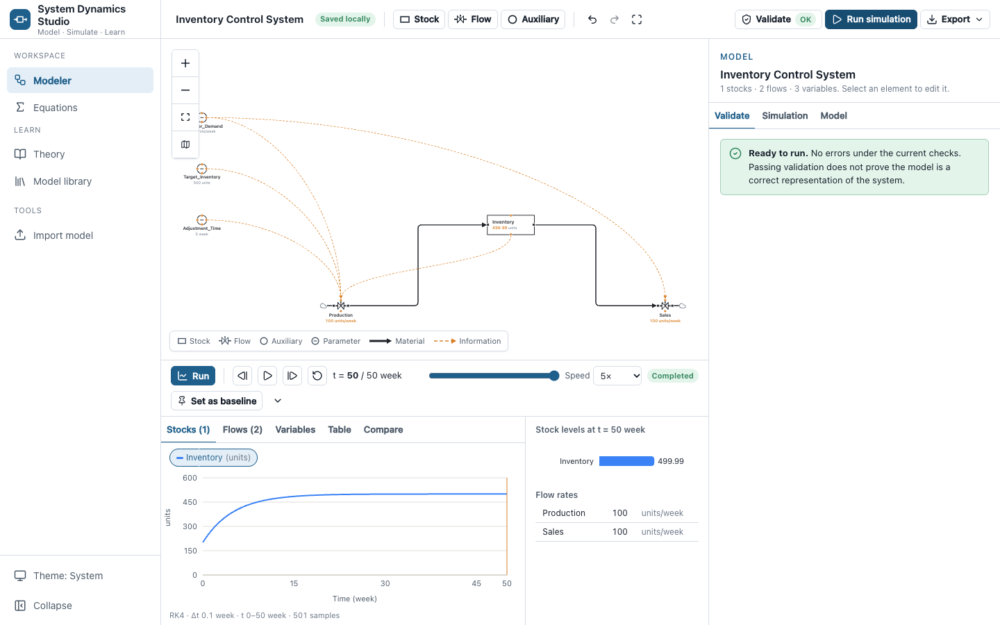
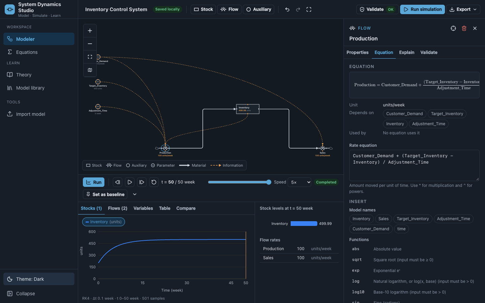
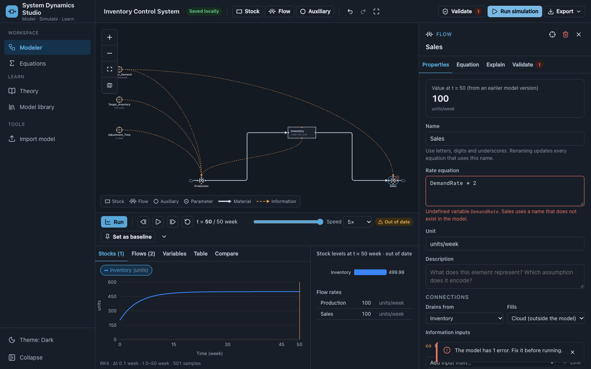
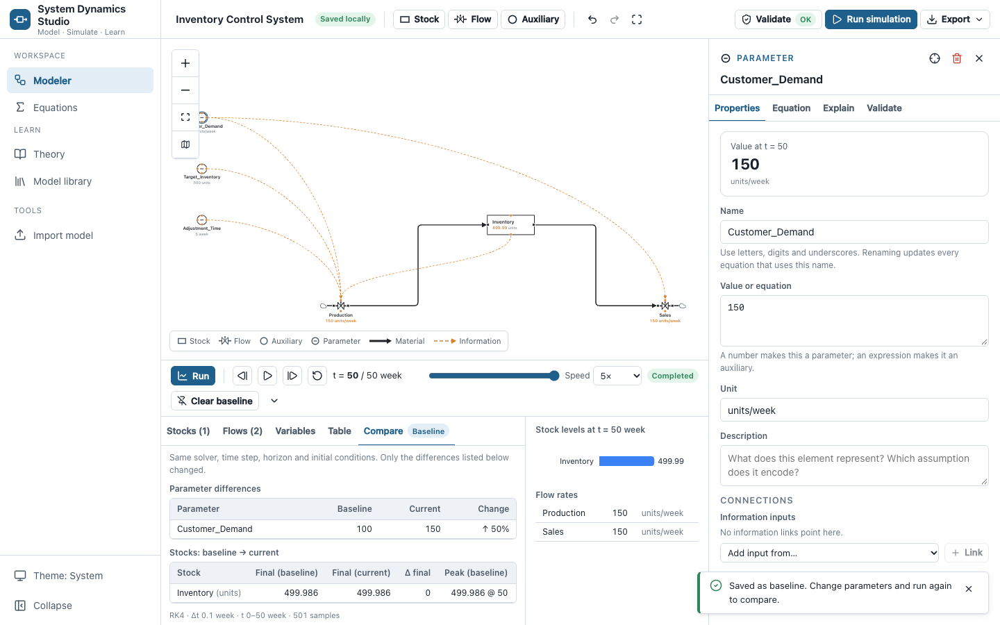
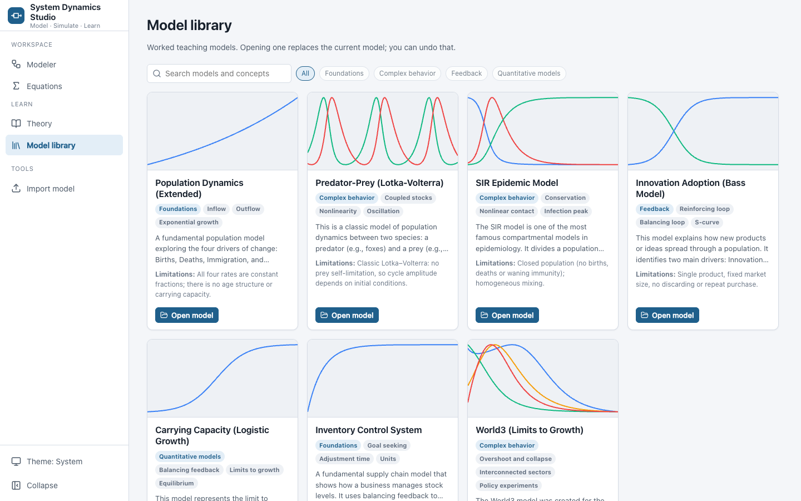

# Current state — Phase 0 audit and first increments

**Branch:** `improve` · **Audit date:** 2026-11-15
**Scope:** PLAN.md Phase 0 (repository audit), then the foundation slices of Phases 1–4 that the inventory vertical slice needs (PLAN.md §6.2).

This document records what was verified, what was wrong, what changed, and what remains. Checkboxes in PLAN.md are ticked only where code and tests support them.

---

## 1. Inventory (as found)

| Area | Found |
|---|---|
| Build | Vite 8, React 19, `reactflow` 11.11, Zustand 5, Tailwind 3.4, Recharts 3, math.js 15, `better-react-mathjax` 3, Prism, Lucide |
| Language | JavaScript (no TypeScript) |
| Source | 13 files, ~2,000 lines: `App.jsx`, `store.js`, `simulationEngine.js`, `examples.js`, `pythonExporter.js`, `rExporter.js`, `Sidebar.jsx` (incl. Theory and code modals), `SimulationPanel.jsx`, `EquationsModal.jsx`, three node components |
| Routes | None: single screen (sidebar + canvas + bottom panel) with three modals (Theory, Eqs, code export) |
| Persistence | **None.** Models lived only in memory; a reload lost all work. No local-storage keys existed, so there was nothing to migrate. |
| Model format | Example objects `{ name, description, maxTime, visibleVariables, colors, nodes, edges }` using React Flow nodes/edges directly. Treated as **schema 0** and migrated (see §4). |
| Tests | None |
| Stray files | `scratch.js` (World3 Euler prototype, not imported; removed), `src/App.css` (Vite template, not imported; removed), unused `src/assets/*` |

## 2. Checks before and after

| Check | Before | After |
|---|---|---|
| `npm run build` | Passes; 1.42 MB single JS chunk (size warning) | Passes, no warning: app 162 kB + vendor chunks (React 190, React Flow 200, Recharts 302, math.js parser 309 kB); Equations, Theory, Library and the code dialog load on demand |
| `npm run lint` | **32 errors, 1 warning** (unused imports, escapes, one real "component created during render" bug in `SimulationPanel`) | **0 errors, 0 warnings** |
| Tests | none | `npm test`: 66 pass, 16 skipped; with interpreters configured (below): **82 / 82 pass** |
| Browser | not checked | Light/dark, all pages, inventory workflow, scenario comparison, undo, reload, 800 px layout exercised in Chrome via Playwright; no runtime errors (one dev-only React Flow StrictMode warning, §7) |

Cross-execution tests run when `SD_PYTHON` (Python with NumPy and SciPy) and `SD_RSCRIPT`/`SD_R_LIBS` (R with deSolve) are set:

```sh
SD_PYTHON=/path/to/python SD_RSCRIPT=Rscript SD_R_LIBS=/path/to/Rlib npm test
```

## 3. README claims: verification matrix

| README claim | Status | Evidence / notes |
|---|---|---|
| React + Vite, React Flow, Zustand, Tailwind | **Confirmed** | `package.json` |
| Stocks, flows, variables; orange dotted information links | **Confirmed, with defect (fixed)** | Variable nodes had no `info` handle, but examples point information links at `targetHandle: 'info'`. React Flow 11 resolves an unknown handle id to `null` when a node has several handles of that type (`getHandle`), so those edges **were never drawn**: 3 of 7 links in Adoption and 4 in World3. The simulator still used the dependencies, so the diagram and equations disagreed. Fixed; the browser test confirms 7/7 Adoption links render. |
| Editable equations | **Confirmed** | Inline inputs in nodes. Now edited in the inspector, with validation, preview and safe rename. |
| Eqs panel with MathJax | **Confirmed** | Now a full Equations page rendered from the same AST the solver compiles. |
| Custom RK4 engine | **Confirmed, with defects (fixed)** | RK4 stages *were* recomputed correctly (fresh scope per stage; matches analytic decay to 2e-7). Defects: (1) time accumulated by `t += dt`, so runs stopped short (Inventory at 49.9 of 50, Predator–prey at 499.9 of 500); (2) any failing equation was swallowed by `try/catch`, so **an undefined symbol silently gave a zero flow and a normal-looking chart**; (3) negative stocks were **silently clamped** to 0; (4) series keyed by label, so duplicate names collided; (5) up to 10 fixed-point sweeps instead of a dependency order, so algebraic loops "converged" silently. |
| Play, pause, reset | **Confirmed, with defect (fixed)** | Each Play re-solved the model and restarted from t = 0, so pause then resume restarted. Solve and playback are now separate. |
| Trend lines and current-stock bars | **Confirmed** | Retained; now unit-aware, with a time cursor, data table and CSV. |
| Theory hub | **Confirmed** | Retained as a reference page. The claim that RK4 provides "highly accurate and stable simulations even for complex … dynamics" was qualified (PLAN.md §2.4). |
| Seven examples | **Confirmed** | All load, validate without errors and simulate to their stop time. The new solver matches the legacy engine to rel. 1e-9 at shared time points (`tests/unit/examples.test.js`). No example relied on the zero clamp. |
| Python export (SciPy `odeint`) | **Generated, but incorrect in general (fixed)** | `^` was copied verbatim, which is **bitwise XOR in Python** (latent: no example uses powers). dt was hard-coded to 0.1. Names were substituted by regex. Now printed from the AST and **executed** in tests: matches a refined app run to rel. 1e-6 (5e-4 with discontinuous inputs). |
| R export (deSolve) | **Generated (improved)** | Used the default adaptive `lsoda` and listed auxiliaries as parameters set to 0. Now uses deSolve's fixed-step `rk4`/`euler` on the app's own time grid; **reproduces the app run to rel. 1e-9** on all examples. |
| "Research-grade", "high-precision numerical stability" | **Not supported** | README wording corrected. |

## 4. What changed (by PLAN.md phase)

### Phase 0 — protection
- Characterization tests pin the legacy engine (`runSimulationLegacy`, kept verbatim) against the new solver on all seven examples.
- Legacy model format is a tested migration fixture: all seven examples migrate to schema 1 and round-trip through JSON without semantic change.

### Phase 1 — design system and domain foundation
- `src/styles/tokens.css`: exact STYLE.md tokens for light and dark. Tailwind colours now map to the tokens; Tailwind preflight is disabled so `global.css` owns element styles.
- `src/app/theme.js`: `light` / `dark` / `system` preference resolved to `data-theme`, persisted, and following OS changes live.
- Shell: 232/64 px collapsible sidebar, 56 px toolbar, 420 px inspector (340 px at 1100 px or narrower), single column at 820 px or narrower.
- Shared components: buttons, fields, cards, tabs (arrow keys), badges, callouts, validation rows, toasts, dialog (focus trap, Escape, focus restore).
- SD notation: stock rectangle, valve-on-pipe flow with clouds at open boundaries, auxiliary circle, parameter circle with a constant bar, thick neutral material pipes vs. orange dashed information links, error/warning markers, legend. All themed.
- Native document (`src/domain/model/document.js`): schema v1 separates `elements` / `links` (domain) from `layout` and `view`; stable ids; migration from schema 0; JSON import/export.
- Undo/redo (100 steps; text edits grouped) and model revisions. Runs are tagged with the revision and shown "out of date" after edits.
- Local draft autosave (`sds.draft.v1`), restored on load. An unreadable or older-schema draft is copied to `sds.draft.backup` before anything else happens.

### Phase 2 — semantics and validation
- Restricted equation language (`src/domain/equations/expression.js`): math.js **parse only**, an AST allowlist, and our own number-only evaluator. No `math.evaluate`, so no implicit units (an undefined `m` would otherwise become "metre"), no strings, matrices or assignments, and no `eval`.
- Compiler (`compileModel.js`): name resolution, duplicate/reserved/identifier checks, dependency graph, **Tarjan SCC algebraic-loop detection** (feedback through stocks is allowed), topological evaluation order.
- Validator (`validateModel.js`): structure (invalid links, orphaned flows, multi-source/target flows), equations, consistency (equation uses X without an information link; link drawn but unused; unused variables), units (declared-string comparison of flow vs. stock/time), numerical settings. Each issue carries severity, category, title, reason and fix. Errors block the run.
- Connections are checked before React Flow draws them (information links cannot enter a stock; material enters through the inflow port).
- Safe rename updates references by identifier boundary, then re-parses to verify; merging two names is refused.

### Phase 3 — verified simulation and playback
- Pure solver (`src/domain/simulation/solver.js`): Euler and RK4, integer-indexed time grid, documented shortened final step, stage-specific time, failure reporting (time, stage, element), and opt-in nonnegativity whose every application is reported.
- Analytical tests: constant inflow S(10) = 32; inventory lab 150 units; exponential decay within 1e-6 and **measured convergence order ≈1 (Euler) and ≈4 (RK4)**; logistic closed form within 1e-6; two-stock and SIR conservation within 1e-9; predator–prey oscillation; determinism; failure and clamp reporting.
- Playback reads the stored run. Speed changes only the cursor cadence. Scrub, step and reset work on the trace; reduced motion jumps straight to the end.

### Phase 4 — analytics and experiments (first slice)
- Stocks / Flows / Variables tabs (one axis per tab, units on the axis), time cursor, failure marker, solver caption, data table with the current row highlighted, CSV with provenance header.
- Baseline vs. intervention: "Set as baseline", dashed overlay, parameter-difference table, stock metrics (final, peak and time, minimum), fairness checks (method, dt, horizon, constraint, initial values, added or removed elements) and run provenance.

### Phase 4 — experiments (second slice)
- `src/domain/scenarios/sweep.js`: sweep grids (linear/log, validated), sweep runs sharing one solver configuration, and local one-at-a-time elasticities ranked by size. Tested against closed forms (inventory final level, decay elasticity −k·t).
- Experiment tab with sweep chart and table and a sensitivity ranking, both labelled as exploratory and marked stale when the model changes.
- The results panel is resizable (drag, or arrow keys on the focused handle) and remembers its height.

### Phase 5 — challenges (first slice)
- `src/domain/assessment/rubric.js`: semantic checks over the model (stocks by initial value, inflow/outflow rates evaluated at the start time, parameter use, units, validation, simulated behaviour). Names and positions are never compared; a run of an older revision does not count.
- `src/data/challenges.js`: build, fix and predict challenges. Each check gives feedback on what to change. Hints are revealed one at a time, and the explanation appears on completion or after all hints. In the predict challenge, the first answer counts.
- Challenges page, live checklist card on the canvas, progress kept in `sds.progress.v1` with a reset option.
- Elements added from the toolbar are placed in free space (`placement.js`); fit-to-view zoom is capped at 100 %.
- Browser-verified: the build challenge can be completed using only the toolbar and inspector, without dragging on the canvas.

### Phase 5 (library and explanations)
- Model library with search and level filters, previews drawn from each model's **actual simulated trajectories**, teaching notes (concepts, intended behaviour, prompts, limitations). World3 is labelled as a teaching sketch, not the calibrated model.
- Contextual "Explain" tab generated from the element's real connections.

## 5. Gap matrix (PLAN.md modules)

| Module | Status | Main gaps |
|---|---|---|
| A Modeler | Partial | No CLD workspace, align/distribute, duplicate or multi-model library; node move is pointer-only (adding elements and connecting them is keyboard-accessible through the toolbar and inspector) |
| B Learning | Partial | Theory page and contextual explanations only; no levelled lessons, live mini-models or knowledge checks |
| C Validator | Mostly done | No dimensional algebra *inside* expressions (only declared stock/flow units are compared); no division-by-zero or domain hazard analysis before running (caught at run time with time and element) |
| D Simulation | Mostly done | No Web Worker or cancel (runs are capped at 200,000 steps); output interval = dt; no run trace |
| E Analysis | Partial | No phase plots, reference curves, settling or oscillation measures |
| F Experiments | Partial | One baseline; parameter sweeps (linear/log, up to 50 runs) and one-at-a-time ±10 % sensitivity ranking done; no two-parameter grids, Monte Carlo or policy schedules (`step`/`ramp`/`pulse` exist as time functions) |
| G Challenges | First slice | Three challenges (build the §5.2 inventory lab, fix a broken cooling model, predict the Bass S-curve), with semantic checks, progressive hints, explanations and local progress; no explain/compare/calibrate/policy challenges or authoring tool yet |
| H Library | Partial | Teaching metadata added; units declared only for Inventory; no beginner/advanced variants |
| I Export | Mostly done | JSON, CSV, Python and R verified; no SVG/PNG, equation report or XMILE |

## 6. Decisions

- **TypeScript:** stay on JavaScript for now (no user-visible gain, high churn). The pure domain modules (`src/domain/**`) are documented and self-contained. Next step: add a `tsconfig.json` with `checkJs` for `src/domain`, then rename domain files to `.ts`. UI later.
- **React Flow:** keep `reactflow` 11. A migration to `@xyflow/react` 12 is separate work with its own regression pass.
- **Persistence:** a single draft in `localStorage` (PLAN.md targets IndexedDB for a multi-model library; that comes with the library feature).
- **math.js:** a parse-only instance (`create({ parseDependencies })`), so evaluation, units and matrices are not even reachable from the app.

## 7. Known issues

- React Flow 11 logs error #002 ("new nodeTypes or edgeTypes object") in development under React 19 StrictMode, because `useMemo` runs twice. The types are module constants; production builds do not log it.

## 8. Reference screenshots

| | |
|---|---|
|  |  |
|  |  |
|  | |
